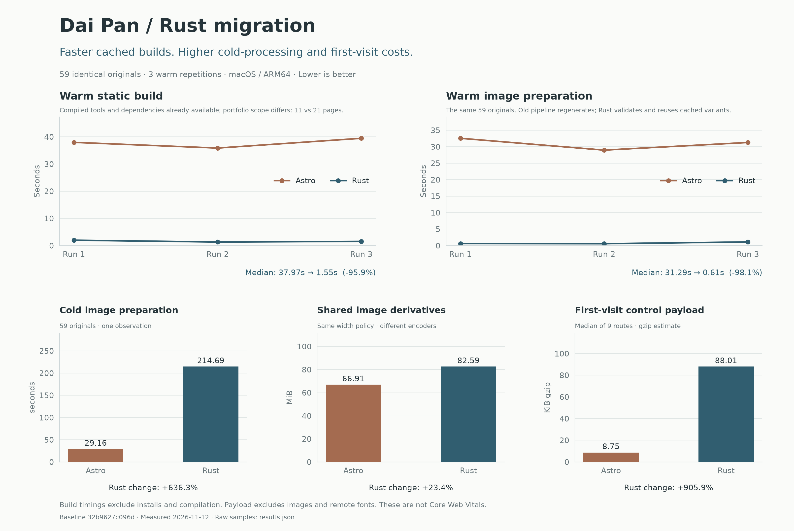

# Dai Pan — Visual Art & Text

[](https://github.com/dpan538/dai-portfolio/actions/workflows/ci.yml)


A portfolio of photography, printmaking, artist books and writing. [daipan.art](https://daipan.art)

Rust generates the static site and implements its browser interactions. Desktop and mobile have independent routes, HTML templates and CSS. Astro and the Node application toolchain have been removed.

## Architecture

- `crates/site` — static HTML compiler, responsive images, metadata, JSON-LD, sitemap, robots, llms.txt and local HTTP preview. Uses `image`, `sha2`, `serde`, `regex`, `tiny_http` and `wasm-bindgen-cli-support`.
- `crates/browser` — menus, galleries, book gestures and route switching, compiled to WASM with `wasm-bindgen`, `web-sys` and `js-sys`.
- `crates/gallery-core` — visual sequencing and layout constraints, evaluated during the build.
- `site/` — maintained HTML/CSS and JSON content. `public/` — original artwork and static assets.

`wasm-bindgen` emits the necessary JavaScript bridge and loader; there is no handwritten JavaScript application. Production is static files on Vercel's CDN, with no Rust or Node server running per request. Image derivatives are cached by source content and encoder policy.

## Development

Install [rustup](https://rustup.rs); `rust-toolchain.toml` pins Rust and the WASM target.

```sh
sh scripts/site serve target/preview 4390
```

Open `http://localhost:4390`. Local review pages and notes are available only in preview builds.

## Build and check

```sh
cargo fmt --all -- --check
cargo clippy --locked --workspace --all-targets -- -D warnings
cargo test --locked --workspace
sh scripts/build-vercel
```

The last command builds `dist/` and checks all generated pages and the Rust architecture. Python 3 is used for verification only. CI also lints the production WASM target. No npm install is needed.

## Hosting and evidence

The existing Vercel project imports GitHub `main`: framework **Other**, build `sh scripts/build-vercel`, output `dist`, empty install command. `vercel.json` records these settings. Production omits local review code, pages and data.

[Migration audit](docs/rust-migration-audit.md) · [Mobile design](docs/mobile-design.md) · [Measured performance report](reports/performance/README.md) · [PNG charts](reports/performance/summary.png)



The report compares the previous production commit with the Rust build, including slower cold image processing and larger first-visit control payloads alongside faster cached rebuilds. It does not claim measured Core Web Vitals improvements.
