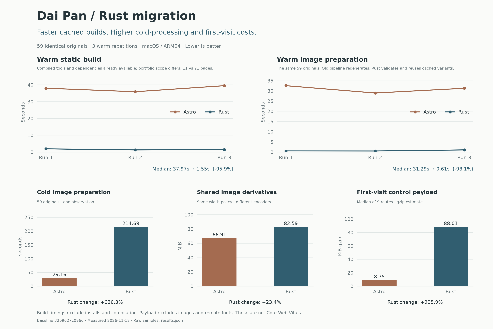

# Rust migration performance

[PNG overview](summary.png) · [Route payload line chart](route-payloads.png) · [Raw JSON](results.json) · [CSV](metrics.csv)



The baseline is `32b9627c096db65c37834800724005d85427aba9`, the commit behind the previous Vercel production deployment. The 59 shared originals are verified byte-identical. New work adds fourteen In Praise of Time photographs and six approved Monolith renders; whole-site output sizes therefore have different content scopes.

Warm timings are medians of three runs on the same Mac, alternating execution order. The image-only comparison uses the same 59 originals and six target widths. The cold Rust image cache is empty; the old script always regenerates derivatives. JPEG quality is 95, PNG remains lossless, but Sharp/libvips and Rust use different encoders/resamplers. Cold timing is one sample. Dependency downloads, native compilation and WASM compilation are excluded. Build measurements include the compiler's image preparation, binding generation and HTML rendering.

Control payloads compare nine canonical routes, summing HTML, local CSS, JavaScript module dependencies and WASM. Each resource is independently gzip-compressed at level 9. Images, remote fonts, headers, CDN behaviour and real network/CPU timings are excluded. This is a byte estimate, **not Lighthouse, LCP, CLS or a real-device result**. Both old and new sites are static; neither requires an application server in production.

The gain is primarily cached rebuild speed. Cold image generation, derivative sizes and first-visit control payload regressions are deliberately visible. A large shared WASM module and the post-load mobile route switch remain costs to address in future work. CI restores the content-addressed image cache; Vercel cold builds should not be assumed to have that cache.

To reproduce, install the pinned Rust toolchain and Node/npm **for the isolated historical baseline only**, then run from the repository root:

```sh
sh scripts/site build dist --production
git archive 32b9627c096db65c37834800724005d85427aba9 -o /tmp/dai-baseline.tar
mkdir /tmp/dai-baseline-benchmark
tar -xf /tmp/dai-baseline.tar -C /tmp/dai-baseline-benchmark
npm ci --ignore-scripts --prefix /tmp/dai-baseline-benchmark
python3 scripts/benchmark.py --baseline /tmp/dai-baseline-benchmark --runs 3
python3 -m venv .cache/report-venv
.cache/report-venv/bin/python -m pip install -r scripts/requirements-report.txt
.cache/report-venv/bin/python scripts/render-performance.py
```

Use a fresh baseline directory each time. The runner refuses a populated Rust image cache and verifies the old lockfile and shared originals before timing. Raw samples and environment versions are retained in `results.json`; detailed logs remain ignored in `target/benchmark/logs`. The candidate source digest covers Rust modules, templates, styles, content, Cargo files, toolchain, build entry point and Vercel configuration. A clean repeat may vary with hardware, filesystem caching and background activity.

The deliverables are standalone PNG charts, not an HTML dashboard. The two top line charts show the three actual repeated runs; single-observation or size comparisons use bars. `route-payloads.png` shows the matched-route profile with categorical route labels. Matplotlib is an optional plotting dependency only and is not part of the Rust site build. These reports stay outside the deployed portfolio.
